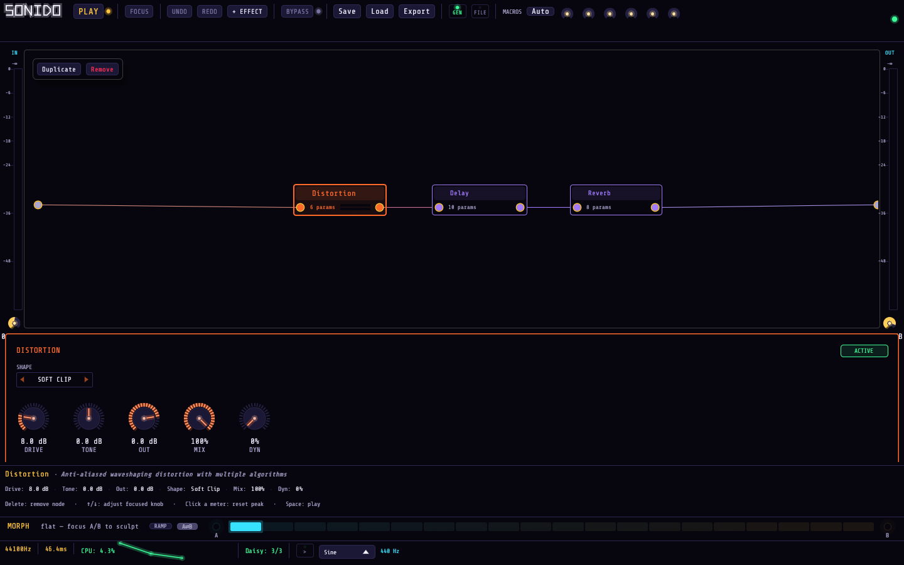
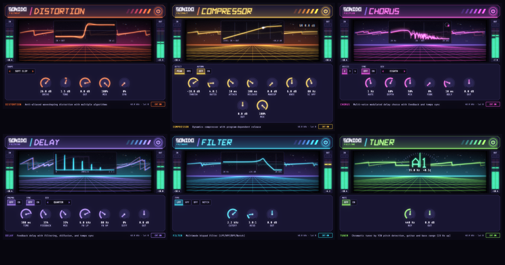

# sonido

[](https://github.com/ampactor-labs/sonido/actions/workflows/ci.yml)
[](LICENSE)

A Rust framework for audio signal processing whose effect kernels run unchanged in CLAP and VST3 plugins, a browser node-graph editor and guitar-pedal firmware. CLAP is an open plugin format for audio workstations; the pedal is an Electrosmith Daisy Seed (a 480 MHz Cortex-M7) in a Hothouse enclosure. The 36 effects are kernels that allocate and smooth nothing while processing; every target builds them through the same registry, wrapped in the same adapter that smooths their parameters, and every effect is level-matched by measurement, so at its defaults it plays at the loudness of its input. The pedal plays rigs through the same runtime as the graph-player plugin, and a knob at noon selects the same default a freshly opened plugin starts at. The distortion kernel on the pedal is the same code as the one in the plugin, compiled for a different target. What differs is the input and output around it: the pedal sums its input to mono and clips at 0 dBFS on the way to its codec, so a pedal and a plugin set to the same values can still sound different at the edges.

**Status: working.** The API may change; nothing is published to crates.io, so the git dependency under Usage is the only install. CI builds, lints and size-checks the ARM firmware, but I test it by flashing it and playing.

Live: https://ampactor.dev/sonido/



## Quick start

The editor runs in the browser with nothing to install: https://ampactor.dev/sonido/ (CI rebuilds it from `main`). Building locally needs Rust 1.85 or later (the workspace uses edition 2024); on Linux the GUI, the CLI and the workspace tests also need the ALSA and X11 development packages listed under `SYSTEM_DEPS` in [.github/workflows/ci.yml](.github/workflows/ci.yml).

```sh
git clone https://github.com/ampactor-labs/sonido
cd sonido
cargo run -p sonido-effects --example chain_demo   # prints two effect chains; needs no audio device
cargo run -p sonido-gui --release                  # the node-graph editor, native
```

On the command line, generate a tone, list the effects, and run the tone through a distortion:

```sh
cargo run -p sonido-cli -- generate tone tone.wav --freq 220 --duration 2
cargo run -p sonido-cli -- effects
cargo run -p sonido-cli -- process tone.wav out.wav --effect distortion --param drive=15
```

## Usage

```toml
[dependencies]
sonido-core = { git = "https://github.com/ampactor-labs/sonido" }
sonido-effects = { git = "https://github.com/ampactor-labs/sonido" }
```

Both crates default to their `std` feature; an embedded build adds `default-features = false`.

The first block calls the kernel directly, as firmware can. `from_knobs` takes six readings between 0 and 1, as an ADC (analog-to-digital converter) delivers them; parameters arrive by reference on every call and the kernel holds only its DSP (digital signal processing) state:

```rust
use sonido_core::kernel::DspKernel;
use sonido_effects::kernels::{DistortionKernel, DistortionParams};

let mut kernel = DistortionKernel::new(48_000.0);
let params = DistortionParams::from_knobs(
    adc_drive, adc_tone, adc_output, adc_shape, adc_mix, adc_dynamics,
);
let (out_l, out_r) = kernel.process_stereo(in_l, in_r, &params);
```

The second block is the desktop path: the registry wraps the same kernel in `Adapter<K, SmoothedPolicy>`, which owns per-parameter smoothing and implements the dynamic effect interface; parameter 0 of the distortion is drive in dB:

```rust
use sonido_registry::EffectRegistry;

let registry = EffectRegistry::new();
let mut effect = registry.create("distortion", 48_000.0).unwrap(); // Box<dyn EffectWithParams + Send>
effect.effect_set_param(0, 15.0); // drive, dB
let output = effect.process(input_sample);
```

Both blocks compile against this commit (checked by hand on 2026-10-22); CI does not compile them, see Testing.

## How it works

Every effect is three layers; the third differs by target:

```
XxxParams            typed params; from_knobs(), lerp(), from_normalized()
    │
XxxKernel            pure DSP; process_stereo(l, r, &Params) -> (l, r)
    │                no allocation in the audio path, no parameter ownership, no smoothing
Adapter<K, Policy>   SmoothedPolicy everywhere a rig plays (plugins, editor, pedal): per-parameter smoothing, 5 to 50 ms ramps by parameter
                     DirectPolicy for firmware examples that drive one kernel: zero-sized, a value is live on the next call
```

The kernel is the part every target shares, and so is the adapter: the pedal firmware builds its effects with `EffectRegistry::create`, as the plugins do, and plays every rig through `sonido_patch::PatchPlayer`, the graph-player plugin's runtime (`crates/sonido-daisy/examples/sonido_pedal.rs`). A freshly loaded rig snaps its parameters to their values instead of sweeping there. `XxxParams` doubles as the preset format, which is why morphing between presets is `lerp()` and nothing more.

Every kernel also declares its level (`const LEVEL: Level`, `crates/sonido-core/src/level.rs`): a trim and the measured correlation between its wet signal and its input. Mixing goes through `Self::blend`, a sine/cosine constant-power law normalized for that correlation, so turning a mix knob does not change the loudness; an effect without a mix control applies the trim itself, before its output knob and safety limiter. The numbers are never hand-tuned: `cargo run -p sonido-effects --example calibrate --release` plays a synthetic strummed guitar peaking at −20 dBFS (the measured median of a humbucker into the Hothouse) through every effect, measures integrated loudness (LUFS) and regenerates `crates/sonido-effects/src/calibration.rs`, and the `level_contract` test fails when the table is out of date.

The distortion, tape and amp kernels use first-order ADAA (antiderivative anti-aliasing, Parker et al., DAFx-2016), which cuts the aliasing that waveshaping creates without oversampling; filters use the RBJ Audio EQ Cookbook formulas; the reverb is an 8-line feedback delay network with a Hadamard mixing matrix (Jot and Chaigne 1991, Dattorro 1997) on Freeverb's delay tunings. `sonido-core` also ships `Oversampled<N>` (2x, 4x, 8x) with a 48-tap Kaiser-windowed sinc downsampling filter, raised from 16 taps to clear 80 dB of stopband attenuation (`crates/sonido-core/src/oversample.rs`), but no shipping path applies it: the registry, plugins, editor and firmware run every kernel at base rate, and only the bench and the core tests exercise the wrapper.

A rig is a directed acyclic graph (DAG): effects are nodes and audio connections are edges, so parallel legs and merges are ordinary topology. `ProcessingGraph` compiles a rig with Kahn's topological sort and buffer liveness analysis (`crates/sonido-core/src/graph/processing.rs`), so a 20-node linear chain runs on two ping-ponged buffers instead of twenty (`crates/sonido-core/src/graph/buffer.rs`). The same topology is scriptable through `sonido-graph-dsl`, with `split(...)` for parallel legs: `split(distortion:drive=20 | chorus; phaser | flanger) | reverb`.

Longer write-ups: [docs/KERNEL_ARCHITECTURE.md](docs/KERNEL_ARCHITECTURE.md) (the three layers), [docs/ARCHITECTURE.md](docs/ARCHITECTURE.md) (the crate graph and data flow), [docs/DESIGN_DECISIONS.md](docs/DESIGN_DECISIONS.md) (32 architecture decision records), [docs/EMBEDDED.md](docs/EMBEDDED.md) (Daisy hardware, memory budgets, flashing over USB DFU, the device firmware update protocol), [docs/EFFECTS_REFERENCE.md](docs/EFFECTS_REFERENCE.md) (all 36 effects and their parameters), [docs/GETTING_STARTED.md](docs/GETTING_STARTED.md) (library, CLI, GUI and WebAssembly walkthroughs), [docs/DESIGN_SYSTEM.md](docs/DESIGN_SYSTEM.md) (the look every Sonido UI shares: tokens, effect families, the plugin cabinet, the CRT pass).

## Benchmarks

Per-effect cost on an Intel i5-6300U (3.0 GHz turbo), measured 2026-10-22 and recorded with the method in [docs/BENCHMARKS.md](docs/BENCHMARKS.md): every one of the 36 effects at its default parameters, one stereo 256-frame block of a 440 Hz sine at 48 kHz, through `Adapter<K, SmoothedPolicy>` (the plugin and editor path), timed with criterion. Reproduce with `cargo bench -p sonido-effects --bench all_effects`. The five most expensive, then the cheapest for scale:

| Effect | 256 frames | ns/frame | One core at 48 kHz |
|---|---|---|---|
| Tuner | 183.99 µs | 718.7 | 3.45% |
| Reverb | 179.76 µs | 702.2 | 3.37% |
| Cabinet | 92.52 µs | 361.4 | 1.73% |
| Amp | 88.61 µs | 346.1 | 1.66% |
| Drone | 81.65 µs | 318.9 | 1.53% |
| Looper | 2.78 µs | 10.9 | 0.05% |

So every effect takes at most 3.5% of one core at 48 kHz on that laptop chip; the full table is in the same file (the amp's row predates a soft-clipper precision fix later that day, which added about 6% to it). Mono costs the same as stereo (the adapter runs the stereo kernel either way, within 2%; ping-pong delay 1.17×), and oversampling the distortion costs 2.11×, 3.86× and 7.50× the base rate at 2×, 4× and 8×.

On the pedal's chip all 36 effects are measured too: `crates/sonido-daisy/examples/bench_kernels.rs` on a Daisy Seed (Cortex-M7 at 480 MHz), loaded over SWD, timing 128 32-sample blocks per effect with the cycle counter against the 320,000-cycle block budget, each effect as a rig runs it (registry-built, smoothed, with the pedal's control tick). Its worst blocks (2026-10-22) are the pedal's cycle table, `crates/sonido-platform/src/cycle_table.rs`, regenerated from the benchmark log by `scripts/update_cycle_table.py` (full table and procedure in the same file). Every effect fits a block alone, worst block included; the reverb is the heaviest pedal effect at 62% of the budget, the tuner the heaviest overall at 64%. One rule, shared by the editor's export check and the pedal, decides what runs: the effects' worst blocks plus 400 cycles per node within 80% of the budget. The whole pedal running distortion → reverb → ringmod (79.4% under that rule) in a Hothouse, audio and controls included, measured 74% on average and 83–85% at its slowest callbacks, with none over budget ([docs/EMBEDDED.md](docs/EMBEDDED.md#chain-configurations)). The ×25 desktop-to-M7 estimate the repo used before (median +14% against the first run's bare-kernel means, 28 of 36 within its ±50%) remains documented there for kernels added later.

### Sound quality

Measured by in-repo tooling at 48 kHz through a 16384-point fast Fourier transform (FFT) with a Blackman-Harris window, and regenerated by `cargo run --release --example dsp_report -p sonido-effects`, which rewrites [docs/DSP_MEASUREMENTS.md](docs/DSP_MEASUREMENTS.md) and the spectrum plot beside it; the run is deterministic.

- Distortion THD (total harmonic distortion) tracks drive on a 1 kHz tone: 13.19% at 10 dB, 33.37% at 20 dB, 41.43% at 30 dB, 43.20% at 40 dB.
- The soft-clip curve is odd-symmetric, as the theory says it should be: at 30 dB drive the third harmonic sits at −9.6 dB relative to the fundamental and the fifth at −14.5 dB, while every even harmonic stays below −114 dB.
- Reverb decay is an RT60 (the time for the tail to fall 60 dB, by Schroeder backward integration) of 3.38 s measured from the kernel's output, with a fit correlation of 0.997.

## Project layout

```
crates/
  sonido-core        DSP primitives, DspKernel and Adapter, Oversampled, the DAG graph engine,
                     true-peak limiting, up-conversion, counter-based random numbers            no_std
  sonido-effects     the 36 kernels and their parameter structs                                no_std
  sonido-registry    create-by-id factory; wraps each kernel in an Adapter                     no_std
  sonido-synth       PolyBLEP (band-limited) oscillators, envelopes, voices, modal banks       no_std
  sonido-platform    hardware control abstractions (knobs, toggles, MIDI)                      no_std
  sonido-patch       the patch format: JSON, binary sector, runtime; pedal state, USB link     no_std
  sonido-rigs        the factory rigs (one set for the pedal and the graph player) and the pedal guide
  sonido-daisy       Daisy Seed firmware and the pedal examples; outside the workspace         no_std
  sonido-analysis    FFT, THD, RT60, GCC-PHAT and other offline analysis
  sonido-io          WAV files and cpal (cross-platform audio) streams
  sonido-config      presets and chain configuration
  sonido-graph-dsl   the text rig format and its builder
  sonido-gui-core    shared egui (GUI toolkit) widgets, theme, parameter bridge
  sonido-gui         the node-graph editor, native and WebAssembly (wasm32)
  sonido-cli         the `sonido` command
  sonido-plugin      the CLAP adapter; every plugin in one bundle
docs/                guides, measurements, decision records
presets/             five example preset chains (TOML); the 8 factory presets live in sonido-config
scripts/             bundle-clap.sh, bundle-vst3.sh, update_cycle_table.py, demo and QA scripts
```

Sixteen crates: fifteen are workspace members, and `sonido-daisy` is excluded because its own `.cargo/config.toml` pins the build to `thumbv7em-none-eabihf`. Seven build without the standard library: six carry `#![cfg_attr(not(feature = "std"), no_std)]` and `sonido-daisy` is `#![no_std]` outright; math goes through `libm`. The applications on top:

- CLI, 12 subcommands (`process`, `realtime`, `generate`, `analyze`, `compare`, `devices`, `effects`, `info`, `play`, `presets`, `patch`, `pedal`): offline processing through a chain or graph string, live input, signal generation, spectrum and impulse-response analysis, rig files (`patch`), and the pedal over USB (`pedal`: list, send, read back and play rigs, update the firmware; `pedal controls` opens an illustrated guide to playing it, drawn from the code the firmware runs). `cargo install --path crates/sonido-cli`.
- GUI (`cargo run -p sonido-gui --release`): the node editor with six macro knobs, the rig's T1/T3 toggles, whole-rig A/B morph, undo, a status bar that applies the pedal's CPU rule as you build, and export to a CLAP preset, a JSON patch or a pedal binary sector, or straight to the pedal over USB (Export ▸ Send to pedal, or Web Serial in the browser), under the rig's name. Its PEDAL window opens the controls guide and plays or erases the pedal's rigs.
- Plugins: one `sonido.clap` bundle holding 37 plugins: all 36 effects, plus `Sonido Graph Player`, which runs a whole rig as one plugin, picked from its built-in factory rigs or the rigs the editor exports. A matching `sonido.vst3` shim exposes the same set as VST3. Every plugin draws the same cabinet UI, lit in its family's color, with live meters and a scope of its own signal. See Plugins below.
- Pedal firmware: `sonido_pedal` for the Cleveland Music Co. Hothouse, a rig player: a jam of three slots, each picked with a knob from eight effects (`JAM_EFFECT_IDS`), in three topologies (linear, parallel, fan) selected with a toggle, up to 15 rigs in its QSPI flash bank, and the six factory rigs (`crates/sonido-rigs`). One control rule everywhere: the left footswitch is on/off, the right one tap tempo (with the A/B toggle in the middle, a glide between A and B), and holding either changes rig; the top row of knobs is levels, with the top right always a volume, and the bottom row the sound. It powers on into the last rig played, saves its state to flash, and takes rigs and firmware-update requests over a USB serial protocol (`sonido_patch::link`). 48 kHz in 32-sample blocks (`BLOCK_SIZE` in `crates/sonido-daisy/src/lib.rs`).

## Plugins



`make plugins` builds the bundle and installs `~/.clap/sonido.clap`; `make plugins-vst3` also builds the VST3 shim and installs `~/.vst3/sonido.vst3`. Rescan plugins in the host afterwards. Each plugin keeps its own ID (`com.sonido.<effect>`), which is what a host saves in a project.

On Linux the plugin window needs the X11 and OpenGL development files, and the VST3 shim needs a C++ compiler and cmake. On Fedora:

```sh
sudo dnf install mesa-libGL-devel libX11-devel gcc-c++ cmake
```

The editor, the CLI and the full test suite additionally need the ALSA headers (`alsa-lib-devel`): on Linux, cpal (the audio I/O library) always builds its ALSA backend, and on a PipeWire system `pipewire-alsa` carries that audio into PipeWire. Debian package names are under `SYSTEM_DEPS` in [.github/workflows/ci.yml](.github/workflows/ci.yml). To keep these off a base system, run the build inside a `toolbox` or `distrobox` container; the plugins it produces load in a host outside it.

The graph player lists the factory rigs, the same six the pedal ships (`sonido_rigs::factory_rigs`), and the rigs in the rig library folder, which the editor's Export ▸ CLAP writes to: `~/.local/share/sonido/patches` on Linux (`$XDG_DATA_HOME` if set), `~/Library/Application Support/sonido/patches` on macOS, `%APPDATA%\sonido\patches` on Windows. Choosing a rig in its RIG selector asks the host to restart the plugin, which rebuilds the rig off the audio thread; the rig is saved with the project.

Why the VST3 needs C++: the shim is [clap-wrapper](https://github.com/free-audio/clap-wrapper), a VST3 front end that finds `sonido.clap` by name at load time and hosts it, so Sonido's DSP and UI exist once, in the CLAP. Building it pulls the VST3 SDK, which is C++. Two ways around the toolchain were considered and not taken. The release workflow already builds the shim per platform, so a script could download it instead of compiling it; that saves a one-time C++ build at the cost of a network dependency and a binary nobody built locally. Writing VST3 natively in Rust would remove C++ entirely, but means maintaining a second plugin-format adapter beside the CLAP one. Because the shim is a loader, a VST3 install only works next to the matching `.clap`: install both.

To see a plugin's UI without a host, `cargo run -p sonido-plugin --bin sonido-preview -- <effect>` opens the same editor in a window, driven by a test signal.

## Deploy

The web editor deploys from [.github/workflows/pages.yml](.github/workflows/pages.yml): on a push to `main` that touches `crates/**` (or a manual dispatch) it runs `trunk build --release --public-url /sonido/` (trunk is the WebAssembly bundler) in `crates/sonido-gui` and publishes `dist/` to GitHub Pages at https://ampactor.dev/sonido/.

Releases come from [.github/workflows/release.yml](.github/workflows/release.yml) on a `v*` tag: it builds the CLI, the GUI, the CLAP bundles (`scripts/bundle-clap.sh`) and the VST3 shims (`scripts/bundle-vst3.sh`, clap-wrapper v0.15.1; VST3 is Steinberg's plugin format) for linux-x64, macos-x64, macos-arm64 and windows-x64, exports the factory presets, and attaches one archive per target to a GitHub release. Releases also carry the pedal firmware, `sonido_pedal.bin` with its SHA-256; update a pedal with `sonido pedal update sonido_pedal.bin` (CI runs upload the same file as the `sonido_pedal` artifact). v0.1.0 (2026-07-20) is the one release so far, with those four archives; the VST3 shims and the firmware joined the workflow after it.

## Testing

```sh
cargo test --workspace                           # what CI runs; on Linux it needs the SYSTEM_DEPS packages
cargo test -p sonido-core                        # 495 unit, 27 integration, 4 property tests, 59 doctests
cargo test -p sonido-effects                     # 367 unit tests plus 129 across twelve integration targets
cargo test --no-default-features -p sonido-core  # the no_std build
```

There are 1,954 `#[test]` functions in the tree (`grep -rho '#\[test\]' crates | wc -l`, 2026-10-22), 1,926 outside the excluded ARM crate, and no `#[ignore]`. The shape of the suite says more than the count:

- Golden-file regression pins the output of 32 of the 36 effects against checked-in references and fails on a mean squared error (MSE) above 1e-6, a signal-to-noise ratio (SNR) below 60 dB or a spectral correlation under 0.9999, each threshold explained next to the constant that sets it (`crates/sonido-effects/tests/regression.rs`). Drone, glitch, texture and time_stretch have no golden file.
- An aliasing suite fails the distortion, preamp, amp and tape kernels when inharmonic energy exceeds 5% of the total, which is what ADAA is supposed to buy (`crates/sonido-effects/tests/aliasing.rs`).
- Property tests (proptest) push every registered effect through random parameter sets and require finite, bounded output and a clean reset; the core primitives get stability and convergence properties, and the patch format gets lossless round-trips and a decoder that never panics on random bytes.
- The registry asserts its own inventory, which is where the number 36 in this README comes from (`crates/sonido-registry/src/lib.rs`).
- The targets start from the same settings: every kernel's params `Default` must equal its descriptors' defaults, the values the plugin, editor and pedal adapters start from (`crates/sonido-effects/tests/default_parity.rs`), and a pedal knob at noon must select that default (`crates/sonido-effects/tests/noon_mapping.rs`).
- Every effect meets the level contract against a synthetic strummed guitar, by integrated loudness: fully wet (or at its defaults, without a mix control) within 0.5 dB of the dry guitar, and within 1.5 dB at 0, 25, 50 and 75% mix and at its default mix (`crates/sonido-effects/tests/level_contract.rs`). The pedal's jam effects stay within 1.5 dB of the dry guitar with every knob at noon (`crates/sonido-platform/tests/knob_calibration.rs`), and each factory rig within 0.5 dB at the middle of its morph and 3 dB at either end (`crates/sonido-rigs/tests/factory.rs`).
- Every registered effect must ship as a plugin with a stable ID (`crates/sonido-plugin/tests/plugin_inventory.rs`), and every shipped preset must convert to a rig with every parameter resolved and in range (`crates/sonido-config/src/patch.rs`, `crates/sonido-config/tests/preset_files.rs`).

On every push and pull request to `main`, [.github/workflows/ci.yml](.github/workflows/ci.yml) runs `cargo fmt --all --check`, `cargo clippy --workspace --all-targets` with `RUSTFLAGS=-D warnings`, `cargo test --workspace` on Ubuntu, macOS and Windows, and a `wasm32-unknown-unknown` build of the editor. Behind `workflow_dispatch`, [.github/workflows/ci-manual.yml](.github/workflows/ci-manual.yml) adds `--no-default-features` tests for the six `no_std` crates, `cargo doc` with warnings denied, the cargo-deny dependency policy, criterion benchmarks compared with critcmp, llvm-cov coverage, and the CLAP conformance checker clap-validator 0.3.2 over every bundled plugin.

Not tested: the ARM path (CI's `firmware` job builds, lints and size-checks `sonido_pedal.bin`, but `sonido-daisy` is outside the workspace and its 28 tests never run in CI; I verify the firmware by flashing it and listening); the VST3 shims (no workflow runs Steinberg's validator; `docs/CHANGELOG.md` records one run by hand); the two Usage blocks above (no doctest includes them); and performance, because the benchmark job uploads a comparison for a human to read and fails nothing.

## Limitations

The on-device numbers were measured by hand (2026-10-22): effect costs on a bare Daisy Seed, then the whole pedal (audio DMA, rig player, controls) running in a Hothouse under guitar, read from the firmware's own load meter. No CI runner can repeat either measurement, so a kernel change can regress the pedal unnoticed until someone re-runs the benchmark and regenerates the cycle table, and a rebuild alone moves unchanged effects by up to ±8% through code layout. The benchmark (`crates/sonido-daisy/examples/bench_kernels.rs`) reads the Cortex-M7's DWT cycle counter (a hardware counter of clock cycles) per 32-sample block and reports each effect's mean and worst block, as a bare kernel and on the rig path, over SWD (probe-rs, no bootloader needed); the bare-kernel table also goes out over USB serial.

Memory is not the constraint on the pedal; CPU is. AXI SRAM, the chip's main working memory, is 512 KB, about 480 KB of it usable once the bootloader has copied the firmware into it (BOOT_SRAM mode), and it holds the code. The firmware therefore puts its whole heap in the 64 MB external SDRAM, where every access costs 4 to 8 wait states: the delay's two-second stereo lines take about 776 KB, the reverb about 118 KB, and the jam's heaviest combination (delay, reverb and chorus) about 0.9 MB. Per-effect heap, as the registry builds each effect, is in the cycle table (`EFFECT_SDRAM` in `crates/sonido-platform/src/cycle_table.rs`) and [docs/EMBEDDED.md](docs/EMBEDDED.md).

The other gaps:

- The ARM firmware is only built in CI. The `firmware` job builds, lints and size-checks `sonido_pedal.bin`, but nothing runs it; I check the pedal firmware and the benchmark harness (`crates/sonido-daisy/examples/bench_kernels.rs`) by flashing them on my desk.
- The pedal's jam offers 8 of the 36 effects (`JAM_EFFECT_IDS` in `crates/sonido-registry/src/lib.rs`); a rig can use any effect, within the CPU rule.
- The editor sends a rig to the pedal by name only: it replaces the bank rig with the same name or takes the first empty slot (`client::choose_send_slot` in `crates/sonido-patch/src/client.rs`), on the first pedal it finds. Its PEDAL window plays and erases bank rigs, but choosing a slot and updating the firmware are CLI-only (`sonido pedal push --slot`, `update`); a firmware update needs `dfu-util` installed.
- Sending from the browser editor over Web Serial is built but untested against a pedal (`crates/sonido-gui/src/web_serial.rs`); it needs Chrome or Edge.
- No shipping path oversamples. Aliasing control rests on ADAA in the distortion, tape and amp kernels, and the aliasing suite measures only those three plus the preamp; no other kernel is measured for aliasing.
- VST3 is unvalidated in CI. The shims come from clap-wrapper (`scripts/bundle-vst3.sh`) and only clap-validator runs in a workflow, so only CLAP has a validation record.
- 4 of the 36 effects (drone, glitch, texture, time_stretch) have no golden regression file.
- No crates.io release, no pinned MSRV (minimum supported Rust version), and the benchmark job has no regression gate.
- The browser build has no file system: presets stay in memory, the export menu downloads the JSON patch and the pedal sector, the controls guide downloads, and writing to the CLAP folder needs the native app (`crates/sonido-gui/src/app.rs`).

It is one person's DSP framework with an unstable API, and it does not try to be a finished plugin suite.

## Roadmap

- The v0.3 list in [docs/ROADMAP.md](docs/ROADMAP.md): MIDI CC mapping with an expression pedal (not started; the platform traits exist), a curated preset library (5 chains ship in `presets/` and 8 factory presets in `sonido-config`, of a planned 20 to 30; the six factory rigs in `sonido-rigs` are shared by the pedal and the graph player), and level-dependent waveshaping in the distortion (the envelope follower already modulates drive; blending the transfer function itself remains).

## License

AGPL-3.0-or-later ([LICENSE](LICENSE)), or a commercial license for shipping closed-source. Terms and contact in [LICENSING.md](LICENSING.md).
